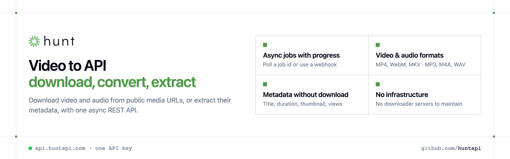

<p align="center">
  <a href="https://www.huntapi.com"></a>
</p>

<p align="center">

[](https://discord.gg/CFj3ph8aHU) [](https://www.huntapi.com) [](https://app.huntapi.com/register) [](https://docs.huntapi.com)

</p>

**HuntAPI** turns media URLs into files and metadata through a simple REST API. Downloads run **asynchronously**: submit a URL, get a `job_id`, then poll the job (or receive a webhook) until the file link is ready.

### Why HuntAPI?

- **Async by design** — submit a URL, get a `job_id`, follow `progress` (0–100) or receive a webhook.
- **Video & audio** — choose quality (up to `1080p` / `best`) and format (`mp4`, `webm`, `mkv`, `mp3`, `m4a`, `wav`).
- **Metadata in one call** — title, duration, thumbnail, channel and view counts without downloading the file.
- **One API key, one header** — `x-api-key` on every request, JSON everywhere.
- **Copy-paste examples** — Python and TypeScript in each README, 7 more languages in `examples/`.

```bash
curl -G https://api.huntapi.com/v1/media/metadata \
  -H "x-api-key: $HUNTAPI_API_KEY" \
  --data-urlencode "query=https://www.youtube.com/watch?v=Z5YP8kznWZs"
```

### Official SDKs

Use HuntAPI from your own language with a typed client:

| SDK | Package | Install |
| --- | --- | --- |
| Node.js | [`@huntapi/sdk`](https://www.npmjs.com/package/@huntapi/sdk) | `npm install @huntapi/sdk` |
| Python | [`huntapi`](https://pypi.org/project/huntapi/) | `pip install huntapi` |
| Go | [`huntapi-go`](https://pkg.go.dev/github.com/huntapi/huntapi-go) | `go get github.com/huntapi/huntapi-go` |
| .NET | [`HuntApi`](https://www.nuget.org/packages/HuntApi) | `dotnet add package HuntApi` |
| Ruby | [`huntapi`](https://rubygems.org/gems/huntapi) | `gem install huntapi` |
| PHP | [`huntapi/sdk`](https://packagist.org/packages/huntapi/sdk) | `composer require huntapi/sdk` |
| Java | [`huntapi-java`](https://github.com/huntapi/huntapi-java) | build from source, see its README |
| CLI | [`@huntapi/cli`](https://www.npmjs.com/package/@huntapi/cli) | `npm install -g @huntapi/cli` |
| MCP server | [`@huntapi/mcp`](https://www.npmjs.com/package/@huntapi/mcp) | `npx -y @huntapi/mcp` |

### Repositories

- [**Audio Download API**](https://github.com/huntapi/audio-download-api) — Extract audio from public media URLs, async
- [**Media Metadata API**](https://github.com/huntapi/media-metadata-api) — Title, duration, thumbnail & views from any media URL
- [**Video Download API**](https://github.com/huntapi/video-download-api) — Download videos from public URLs with an async API
- [**YouTube to MP3 API**](https://github.com/huntapi/youtube-to-mp3-api) — Convert YouTube videos to MP3, M4A or WAV via API
- [**YouTube Video Downloader API**](https://github.com/huntapi/youtube-video-downloader-api) — Download YouTube videos and metadata with one API

---

💬 [Discord](https://discord.gg/CFj3ph8aHU) · 📚 [API reference](https://docs.huntapi.com) · 🔑 [Get your API key](https://app.huntapi.com/register) · 🌐 [www.huntapi.com](https://www.huntapi.com)
